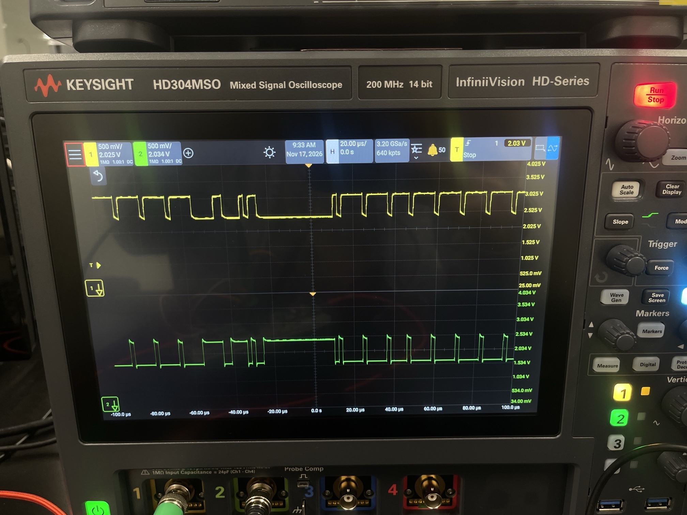

# Lab 8 – CAN Bus Observations

- `src/activity1.c` – one board transmits (ID `0x200`, every 3 s), the other receives and logs.
- `src/activity2.c` – both boards send and receive. Board A (`BABBLER 1`) babbles ID `0x010`
  continuously with a `busy_wait_us(BABBLE_DELAY_US)` between attempts; board B (`BABBLER 0`)
  sends ID `0x400` every 100 ms. Board A prints every `0x400` frame it receives.

## Activity 1 – Communication and electrical behavior

In this activity, we connected simple transmission and one transceiver sent a message while the other transceiver received messages.
The transmitter's `sent N` messages were received as `received N` on the other board.

CH1 = CANH, CH2 = CANL, both referenced to GND, 500 mV/div, 20 µs/div.

| Bus state | CANH | CANL | CANH − CANL | Logic |
|---|---|---|---|---|
| Recessive | ≈ 2.6 V | ≈ 2.3 V | ≈ 0 V | 1 |
| Dominant  | ≈ 3.0 V | ≈ 1.6 V | ≈ 1.4 V | 0 |

- The two lines mirror each other: during a dominant bit CANH is pulled up and CANL pulled
  down. Receivers read the *difference*, so noise that couples equally onto both wires cancels.
- Recessive is the undriven state (the termination resistors pull the lines together), so any node
  driving dominant overrides every recessive node. Arbitration and ACK both rely on this.
- The shortest pulse is about 2 µs, one bit time at 500 kbit/s.
- Runs of 5 identical bits are followed by an opposite stuff bit. That is the repeating
  "5 dominant, 1 recessive" pattern visible in the frames.
- The differential swing (~1.4 V) is below the textbook ~2 V. That is typical of a 3.3 V transceiver.

### Microcontroller lines (GP5 = TX, GP4 = RX)

Probed on the scope with CH1 on GP5 and CH2 on GP4, both referenced to Pico GND.

- Both lines are single-ended 0–3.3 V logic.
- A dominant bit is **low** (0 V) and recessive is **high** (3.3 V). That is the same polarity as CANL and
  inverted relative to CANH.
- RX follows TX with the same bit pattern as the bus, slightly delayed by the transceiver. The node
  reads back its own transmission through the transceiver.
- TX shows only this node's own bits, while RX shows the whole
  bus. So in the ACK slot the sender's TX stays recessive while its RX goes dominant, because the
  other node acknowledges. During lost arbitration, TX and RX differ in the same way.

## Activity 2 – Babbling node

Board A babbles the **high-priority** ID `0x010`; board B sends the **lower-priority** ID `0x400`
every 100 ms (10 frames/s). The babbler overwrites the lower priority messages.

One 4-byte standard frame (including the 3-bit interframe space) is 79 bits plus stuff bits, about 80–95 bits ≈ **160–190 µs** at 500 kbit/s.

### Results

| Babble delay | Evidence | `0x400` frames received by A | Board B `can2040_transmit` |
|---|---|---|---|
| 0 µs | [scope](img/scope_0us.jpg) | – (bus saturated with `0x010`) | – |
| 1 µs | [serial](img/serial_1us.png) | bursts of 4 (0–3, 62–65, 833–836); almost all lost | always `-1` (TX queue full) |
| 100 µs | [scope](img/scope_100us.jpg), [serial](img/serial_100us.png) | almost none: A printed nothing while B sent 8334–8373 (an earlier 10 s capture got only 34 of 540, in bursts of 4) | always `-1` |
| 150 µs | [serial](img/serial_150us.png) | one burst of 4 (9293–9296), the rest lost | mostly `-1`, briefly `0` when the queue drained (9310–9313) |
| 155 µs | [scope a](img/scope_155us_a.jpg), [scope b](img/scope_155us_b.jpg), [serial](img/serial_155us.png) | **most**: the ones B got `-1` on (11002, 11018, 11020, 11029–11030, …) are missing, and some are received **multiple times** (11009 ×3, 11012 ×4, 11026 ×6) | mixed `0` / `-1` |
| 160 µs | [serial](img/serial_160us.png) | **all of them**, no gaps (10503–10542) | `0` |
| 175 µs | [serial](img/serial_175us.png) | **all of them**, no gaps (9959–9998) | `0` |
| 200 µs | [scope](img/scope_200us.jpg), [serial](img/serial_200us.png) | **all of them**, no gaps (7510–7549) | `0` |
| 1000 µs | [scope](img/scope_1000us.jpg), [serial](img/serial_1000us.png) | **all of them**, no gaps (7163–7202) | `0` |

Board B puts an incrementing sequence number in its data field, so gaps in A's `received N` output are lost messages.

### Observations

- **Starvation (0–150 µs).** When the babbler queues a new frame faster than one frame time, it
  always has a frame pending when the bus goes idle, wins arbitration with `0x010`, and B never
  gets the bus. B's 4-entry transmit queue fills, and every later `can2040_transmit` returns `-1`.
  The occasional bursts of exactly 4 received messages happen when the babbler briefly has
  nothing pending: B's whole queue drains, and everything sent meanwhile is lost.
- **Threshold (about 155 µs; fully reliable at 160 µs).** Once the babble period is longer than one
  frame (about 160 µs), the bus goes idle between babbler frames. 150 µs is still shorter than a
  frame, so B stays starved. 155 µs is right at the edge: whether the bus goes idle depends on the
  exact frame length, which varies by a bit or two with stuff bits. B gets through most of the time
  but still overflows its queue now and then. From 160 µs on (plus the loop's own overhead), B
  gets through every time.
- **Duplicate frames at the edge.** At 155 µs, board A received some of B's messages several times.
  The same frame was retransmitted after A had already accepted it. This is consistent with CAN's
  automatic retransmission: if the transmitter detects an error late in the frame (or misses the
  ACK), it resends, even though receivers may have already accepted the original. When the bus is
  this close to saturated the timing is marginal, so it shows up. CAN guarantees delivery "at least
  once", not "exactly once". At 200 µs the scope shows an idle
  gap of only about 30–40 µs, but that is enough for B to start its frame. Every `0x400`
  message was then delivered.
- **1000 µs.** The bus is mostly idle. The scope shows 160+ µs of recessive bus after each
  frame.
- **Takeaway.** CAN priority is strict, not fair. A faulty high-priority node can starve every
  lower-priority node on the bus, without causing a single error frame. Real controllers use
  rate limiting, a bus guardian, or error confinement to protect against this.

### Failure seen while testing

During one run, board B returned `-1` from the very first message and the babbler received
nothing, at every delay. A debug build that printed *all* received IDs showed neither board
heard the other. The cause was a loose wire. Without a second node to ACK, the CAN controller
retransmits the same frame forever, so the scope still showed "traffic" even though nothing
was delivered. After reseating the wiring, the 200 µs and 1000 µs runs above worked.

## Fallacies of distributed computing seen in this lab

- **The network is reliable.** A single loose wire silently stopped all delivery, and the sender only
  saw `-1` (queue full), never an explicit failure.
- **Bandwidth is infinite.** At 500 kbit/s the bus carries only about 5,000 frames/s, and one node used all of it.
- **Latency is zero.** Even at the 200 µs threshold, B's message waits for the babbler's frame to finish.
- **The network is secure / there is one administrator.** Any node can transmit any ID. Nothing
  stops a misbehaving node from claiming the highest priority.
